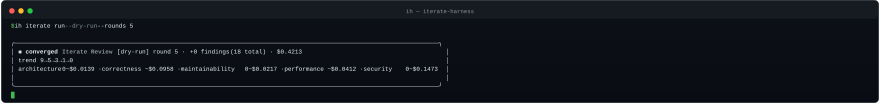

<div align="center">
  
</div>

<div align="center">
  
</div>

## 👋 关于我 · About Me

- 🎓 **16 岁，上海高中生** —— 作业写完才开机，代码都在深夜和周末生长。<br>
  A 16-year-old high schooler in Shanghai — most of my code grows after homework, on weekends and at midnight.
- 🤖 **我关注的命题**：AI 不该只是「写完就走」，无论是代码还是界面，它都应该拿出证据——计划、评审、修复、验证、回环。<br>
  My obsession: AI shouldn't just write and leave. Whether it's code or UI, it should show evidence — plan, review, fix, verify, loop.
- 🛠️ **[iterate](https://github.com/jingzhao-l/iterate-skill) 生态作者**：一套围绕「多轮审查-修复闭环」的工具体系，见下方三件套。<br>
  Author of the **iterate** ecosystem — a toolchain built around the multi-round review-fix loop.
- 🪟 **[GlassPane](https://github.com/jingzhao-l/GlassPane) 生态作者**：让 macOS 上的 AI 代理真正操作界面并交出可审计证据，引擎 + agent harness 两条线。<br>
  Author of the **GlassPane** ecosystem — giving macOS agents real UI control plus auditable evidence, across an engine and an agent harness.

## 🧭 我在做什么 · What I'm Building

| | 问题 · Question | 我的答案 · My answer |
|---|---|---|
| 🛠️ **iterate** | 这段代码真的写对了吗？<br>Is this code actually right? | 多轮审查 → 原子修复 → 再验证，直到 findings 收敛到 0<br>Multi-round review → atomic fixes → re-verify until findings converge to zero |
| 🪟 **GlassPane** | 这个操作真的生效了吗？<br>Did that operation really take effect? | 让 agent 操作真实 UI，测量变化、判定归因、留下证据<br>Operate the real UI, measure the change, attribute it, and keep the evidence |

一个管**代码正确性**，一个管**运行时真实性**；两条线还共用同一套哈希链记录格式，可以互相验证对方的结论。<br>
One checks **code correctness**, the other **runtime truth**; both share one hash-chain record format and can verify each other's claims.

## 🚀 iterate 生态 · The iterate Ecosystem

一句话：**把「AI 写完就走」变成「AI 自己审、自己改、自己验证」**。<br>
One line: turning "AI writes and prays" into "AI reviews, fixes and verifies its own work — round after round".

<div align="center">



<sub>iterate-harness 的收敛面板：5 轮把 18 个 findings 清到 0，每个维度精确计费<br>
The iterate-harness convergence panel: 18 findings driven to zero in 5 rounds, with exact per-dimension billing</sub>

</div>

| 仓库 · Repo | 是什么 · What it is |
|---|---|
| 🧠 **[iterate-skill](https://github.com/jingzhao-l/iterate-skill)** | 面向对话式 agent 的多轮审查-修复技能：9 维度评审、双轨修复、决策日志、项目知识库<br>A skill for conversational agents: 9-dimension review, dual-track fixes, decision log, project knowledge base |
| ⚙️ **[iterate-harness](https://github.com/jingzhao-l/iterate-harness)** | 专为 iterate 打造的 coding harness（`ih` CLI + React TUI）：在 CI/PR 里无人值守地跑完整审查-修复闭环，含成本计量与阈值门禁<br>A coding harness purpose-built for iterate: runs the full review-fix loop unattended in CI/PR, with cost metering and threshold gates |
| 🖥️ **[iterate-plugin](https://github.com/jingzhao-l/iterate-plugin)** | 桌面插件：收敛仪表盘、逐轮进度、实时干预<br>Desktop plugin: convergence dashboard, round-by-round progress, live intervention |

三者共享同一套 `iterate.config.yaml` 与维度体系 —— **skill 给对话，harness 给 CI，plugin 给桌面**。<br>
All three share one config and one dimension system — **skill for chat, harness for CI, plugin for desktop**.

**一键安装 · One-liner install**<br>

- 🧠 skill → `npx iterate-skill-installer`
- ⚙️ harness → `npm install -g iterate-harness` 或 `pip install iterate-harness`
- 🖥️ plugin → `dsh plugin --profile web add github:jingzhao-l/iterate-plugin#main`

## 🪟 GlassPane 生态 · 让 agent 交出证据

一句话：**AI 代理在 macOS 上说"我点过了、界面变了"，GlassPane 要它拿出证据**。<br>
One line: when an agent on macOS claims "I clicked it and the UI changed", GlassPane makes it show the receipts.

| 仓库 · Repo | 角色 · Role | 是什么 · What it is |
|---|---|---|
| 🪟 **[GlassPane](https://github.com/jingzhao-l/GlassPane)** | 引擎 · Engine | Swift 写的运行时验证引擎 + launchd 守护进程；通过 MCP 暴露 `gp_*` 工具，测量操作前后的 AX 树与像素变化，给出归因、诊断与回滚，并归档证据包<br>A Swift runtime-verification engine + launchd daemon exposing `gp_*` tools over MCP: AX-tree and pixel deltas, attribution, diagnosis, rollback and archived evidence packs |
| 🤖 **[glasspane-harness](https://github.com/jingzhao-l/glasspane-harness)** | Agent · Harness | 完整的 macOS coding agent（opencode fork），把 `gp_*` 接进日常会话：操作真实元素、读取引擎判定、把每次验证写进哈希链决策日志；CLI/TUI + 内嵌 Web UI，带 `glasspane-harness` / `gp-harness` 两个命令<br>A complete macOS coding agent (opencode fork) with `gp_*` wired into the session: operate real elements, read the engine's verdicts, and append each verification to a hash-chained decision log — CLI/TUI plus embedded web UI |

**分工**：引擎负责**测量与判定**，harness 负责**使用判定**。归因、诊断类别、熔断等级、pass/fail/inconclusive 都由 Swift 引擎计算；harness 只转写，不自己发明结论。<br>
**The split**: the engine **measures and judges**; the harness **uses the judgement**. Attribution, diagnosis class, circuit-breaker level and the pass/fail/inconclusive outcome are computed in Swift — the harness transcribes, and never invents a verdict.

| 能力 · Capability | 是什么 · What it is |
|---|---|
| 🔍 **证据包 · evidence packs** | 每次界面操作留下可回放的档案：操作前后的 AX 结构对比、像素对比、耗时与通道存活指标<br>Every UI operation yields a replayable pack: AX-tree diff, pixel diff, timing and channel-liveness metrics |
| 🧭 **归因 · attribution** | 分清"这次变化是这次操作造成的"还是别人造成的；判不动的时候如实说判不动，不猜<br>Separates a change caused by *this* operation from one caused by something else — and says so when it can't decide |
| ⏪ **回滚 · rollback** | 探针 SDK 的检查点可以把目标应用拉回操作前的状态（tier-1 全量 / tier-2 重放两条路径）<br>Probe-SDK checkpoints restore the target app — tier-1 full restore and tier-2 replay |
| 🔐 **权限面 · TCC surface** | 辅助功能／输入监控／屏幕录制／开发者工具四类席位：逐卡引导 + 机器实测，面板显示的是**授权主体自己**的状态<br>Four TCC seats with per-card guidance and machine-run verification — the panel shows the granting subject's own state, never a guess |
| 🤝 **接入 · wiring** | Swift 引擎 + 后台守护进程，任意 MCP 客户端（Claude / Cursor / …）通过 `gp_*` 工具驱动；harness 则把同一套工具直接接进 agent 会话<br>Swift engine + launchd daemon driven by any MCP client through `gp_*`; the harness wires the same tools straight into the agent session |

**安装 · Install**

```bash
# GlassPane 引擎（macOS 14+）
curl -fsSL https://raw.githubusercontent.com/jingzhao-l/GlassPane/main/install.sh -o /tmp/gp-install.sh && sh /tmp/gp-install.sh
# 或通过 npm 引导安装
npx glasspane-install

# glasspane-harness（npm，macOS 13+；gp_* 工具需要上面的引擎在运行）
npm install -g glasspane-harness
glasspane-harness          # 交互式 TUI；也提供 glasspane-harness run / serve
```

<p align="center">
  <a href="https://www.npmjs.com/package/glasspane-mcp"></a>
  <a href="https://www.npmjs.com/package/glasspane-install"></a>
  <a href="https://www.npmjs.com/package/glasspane-harness"></a>
  <a href="https://github.com/jingzhao-l/glasspane-harness/actions/workflows/ci.yml"></a>
  
</p>

它自己也在吃 iterate 的狗粮：GlassPane 仓库里内置的 [`@iterate/kernel`](https://github.com/jingzhao-l/iterate-skill) 就是生态共用的那套内核（schema 真源 + 双语言契约），每次大改都由 iterate 的审查-修复闭环过一遍。<br>
It also dogfoods iterate: the `@iterate/kernel` vendored inside GlassPane is the same shared kernel the rest of the ecosystem runs on (schema truth source + dual-language contracts), and each big pass goes through iterate's review-fix loop.

**两条线已经能互相校验**：从 2026-10-25 起，GlassPane 的证据账本和 iterate 的决策日志使用同一种哈希链格式；引用对方文件里的结论时，先做链上校验再采信。今天读取端在 iterate 一侧（`ih iterate gate` / `ih iterate glasspane-ledger <path>`），一个固定点测试证明这里写的链在那边验得过。<br>
**The two lines can already check each other**: since 2026-10-25, GlassPane's evidence ledger and iterate's decision log share one hash-chain format, and a claim quoted from the other side's file is chain-verified before it is used. The reader lives on the iterate side today (`ih iterate gate` / `ih iterate glasspane-ledger <path>`), and a fixed-point test proves a chain written here verifies there.

## 🛠️ 技术栈 · Tech Stack

<div align="center">


</div>

## 📥 下载量 · Downloads

全渠道累计下载（每小时自动更新 · all-time, auto-updated），数据源见 [`downloads.json`](./downloads.json)。GlassPane 只统计 `glasspane-mcp` 和 `glasspane-harness`：`glasspane-install` 只是引导安装 `glasspane-mcp`，`install.sh` 的 curl 安装也无法计数，两者都不重复计入。<br>
All-time downloads refreshed hourly; the source data is [`downloads.json`](./downloads.json). GlassPane counts only `glasspane-mcp` and `glasspane-harness`: `glasspane-install` merely bootstraps `glasspane-mcp`, and `install.sh` curl installs cannot be counted — neither is added on top.

**总计 · All ecosystems**

| | 下载 · Downloads |
|---|---|
| 🌍 **全部合计 · All total** |  |

**iterate**

| 项目 · Project | 下载 · Downloads |
|---|---|
| 🌱 **生态合计 · Ecosystem total** |  |
| 🧠 iterate-skill（ClawHub + SkillHub + npm） |  |
| ⚙️ iterate-harness（npm） |  |
| ⚙️ iterate-harness（PyPI） |  |
| 🖥️ iterate-plugin（npm） |  |

**GlassPane**

| 项目 · Project | 下载 · Downloads |
|---|---|
| 🪟 **生态合计 · Ecosystem total** |  |
| 🪟 glasspane-mcp（npm） |  |
| 🤖 glasspane-harness（npm） |  |

## 📊 统计 · Stats

<div align="center">


</div>

## 🧭 别处 · Elsewhere

| 仓库 · Repo | 一句话 · What it is |
|---|---|
| 🤝 [agent-collaboration-fabric](https://github.com/jingzhao-l/agent-collaboration-fabric) | 跨平台、本地优先的 AI coding agent 协作层<br>A local-first collaboration layer for AI coding agents across platforms and sessions |
| 📚 [awesome-claude-skills](https://github.com/jingzhao-l/awesome-claude-skills) | Claude Skills 精选清单<br>A curated list of Claude Skills |
| 📚 [awesome-dsh-plugin](https://github.com/jingzhao-l/awesome-dsh-plugin) | DeepSeek Harness 插件精选清单<br>A curated list of dsh plugins |
| 🔬 [mnist-snn-hardware-tradeoff](https://github.com/jingzhao-l/mnist-snn-hardware-tradeoff) | 在 Cadence 180nm 模型上做脉冲神经网络的精度-能耗折中分析（我想看看硅上的神经元的另一头）<br>SNN accuracy-vs-energy trade-off on Cadence 180nm models — the silicon end of the same curiosity |

---

<div align="center">


<br><br>
<sub>⭐ 如果 iterate、GlassPane 或 glasspane-harness 帮到了你，欢迎去仓库点个 Star · If any of them helps you, a star means a lot</sub>
<br><br>


</div>
